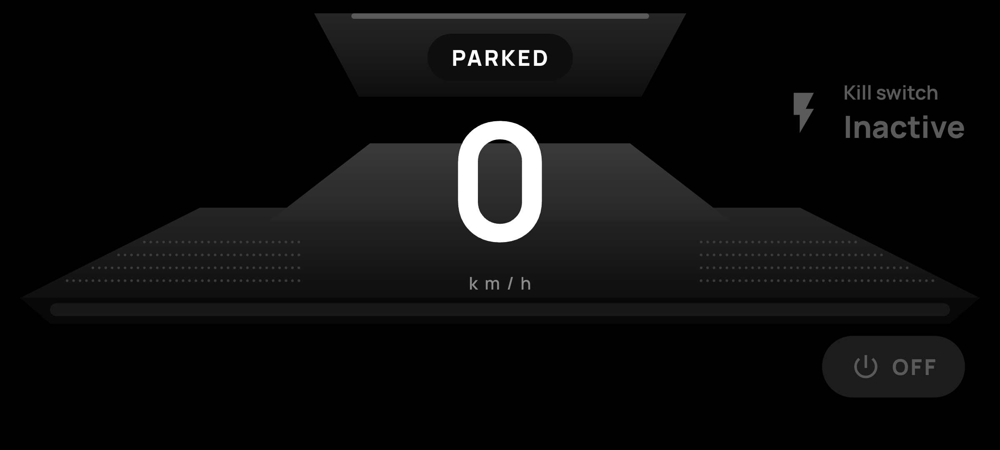
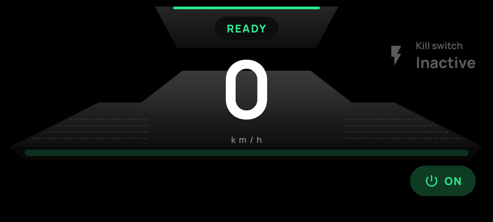
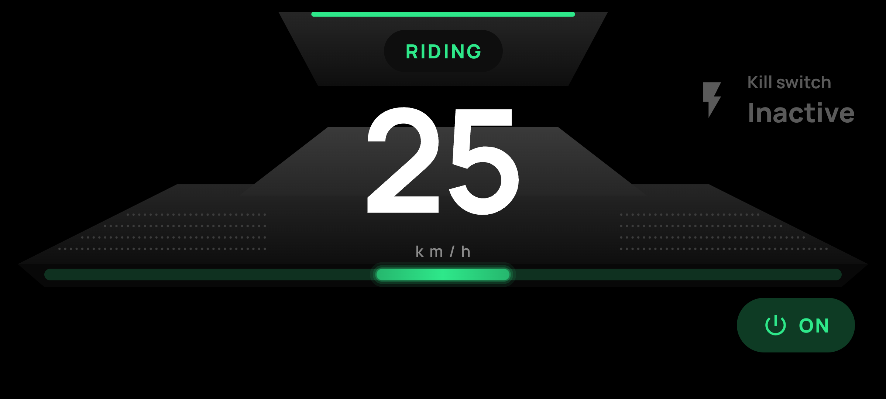
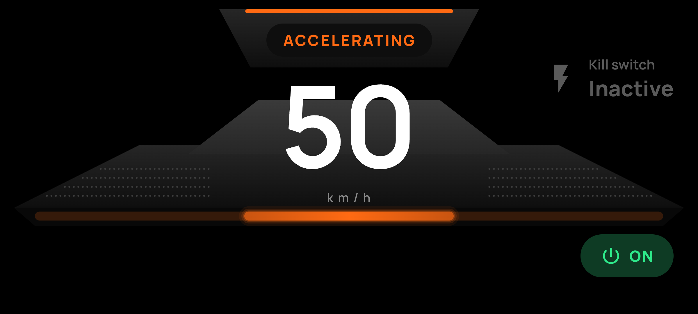
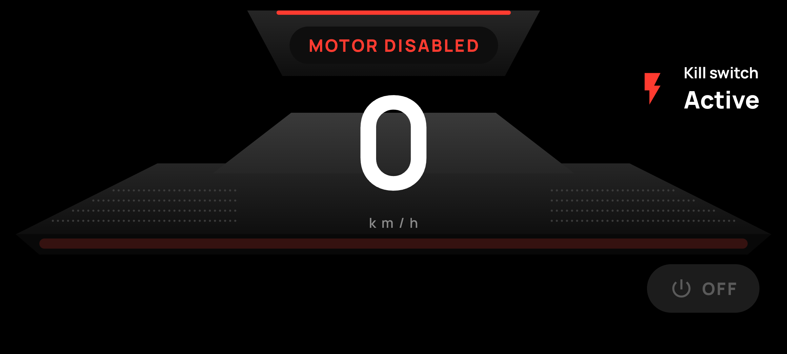
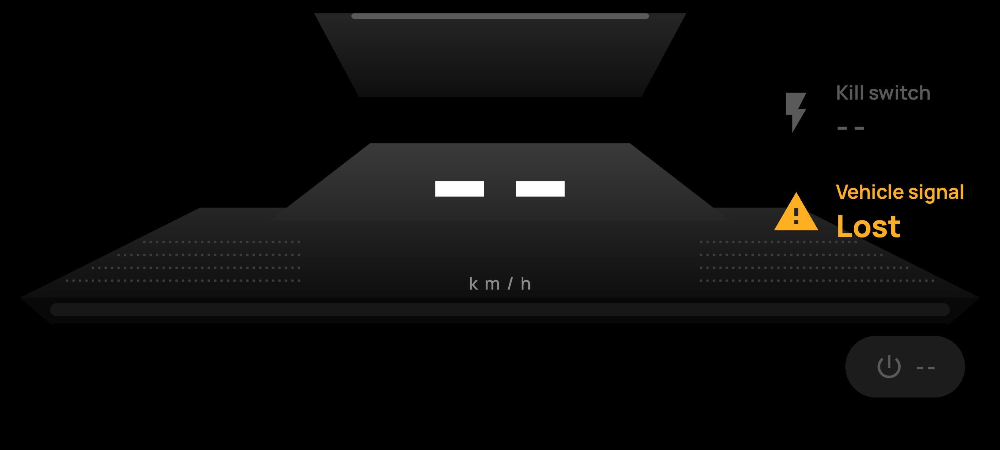
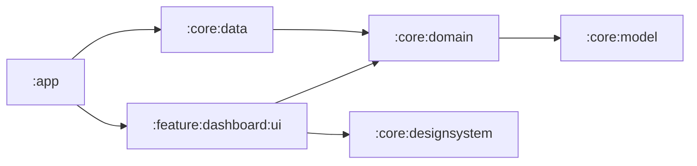
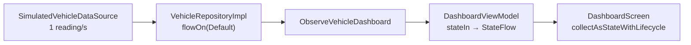

# RideHmi

A landscape Android HMI ride dashboard. It shows vehicle speed (km/h), motor status (ON/OFF) and
kill-switch status (Active/Inactive), updating live from a simulated vehicle that sends one reading
a second. Built with Kotlin, Jetpack Compose, Coroutines, Flow/StateFlow, ViewModel and Hilt.

| Parked | Ready | Riding |
|---|---|---|
|  |  |  |
| **Accelerating** | **Motor disabled** | **Signal lost** |
|  |  |  |

## Requirements checklist

| Requirement | Where it's met |
|---|---|
| Speed in km/h, updating automatically | `SpeedReadout` in `DashboardScreen`, plus the `SpeedDeck` light bar, which grows with speed |
| Motor ON/OFF, clearly shown | `MotorPill`: green pill with a power icon and "ON", or grey "OFF" |
| Kill switch Active/Inactive, distinct visuals | `KillSwitchAlert`: red bolt and white "Active", or dimmed grey "Inactive". Colour, icon and text all change. |
| Reactive UI, no manual refresh | `Flow` → `StateFlow` → `collectAsStateWithLifecycle` |
| Simulated data about once a second, Coroutines + Flow | `SimulatedVehicleDataSource` |
| Parked, Ready, Riding, Accelerating, Motor disabled | `RideSamples.normal`, a 17-second loop; see [Simulated ride](#simulated-ride) |
| ViewModel-based state management | `DashboardViewModel` exposes one `StateFlow<DashboardUiState>` |
| Separate UI, ViewModel and data provider | Separate Gradle modules; see [Architecture](#architecture) |

## Build and run

You need:
- **Android Studio:** a recent version that supports Android Gradle Plugin 9.4.
- **Android SDK:** compile SDK 37.
- **Emulator or device:** any running API 26 or higher.

Gradle downloads the JDK it needs on its own. The code targets Java 17.

```bash
git clone https://github.com/Tanvi-Goyal/RideHmi.git
cd RideHmi
./gradlew installDebug      # with an emulator running
```

Or open the project in Android Studio and run the `app` configuration. The app opens in landscape
and starts the simulated ride straight away.

## Architecture

The modules follow clean architecture, and dependencies point inward. Domain and model are plain
Kotlin, with no Android code, so their logic is tested on the JVM.



| Module | Holds |
|---|---|
| `:core:model` (JVM) | Plain models: `VehicleReading` (raw), `Signal<T>` (Valid / Missing / Invalid), `VehicleStatus`, `RideState`, `VehicleDashboard`, `MonotonicClock` |
| `:core:domain` (JVM) | The `VehicleRepository` interface, `VehicleSignalValidator`, `RideStateMachine` and the `ObserveVehicleDashboard` use case |
| `:core:data` | `SimulatedVehicleDataSource`, `VehicleRepositoryImpl` and the Hilt modules |
| `:feature:dashboard:ui` | `DashboardViewModel`, `DashboardUiState`, the mapper, `DashboardScreen` and its components |
| `:core:designsystem` | The always-dark theme, colours, text styles, strings, icons and the Manrope font |
| `:core:testing` (JVM) | Test fakes (`FakeVehicleRepository`), `MainDispatcherRule` and the `reading(...)` helper |
| `:app` | `HmiApplication` (the Hilt root) and `MainActivity` |
| `build-logic` | Gradle convention plugins (`ridehmi.*`); versions live in `gradle/libs.versions.toml` |

Swapping the simulator for a real vehicle bus means writing a new `VehicleDataSource`. Nothing above
the data layer changes.

### How a reading reaches the screen



`ObserveVehicleDashboard` turns raw readings into `Connecting`, `Live(status, rideState)` or `SignalLost`:

1. **Drops late or repeated readings,** using their monotonic timestamp.
2. **Validates each signal** to `Valid`, `Missing` or `Invalid` (`VehicleSignalValidator`).
3. **Works out the ride state** (`RideStateMachine`).
4. **Shows `SignalLost`** when no reading arrives for 3 s.
5. **On a source error,** shows `SignalLost`, waits 1 s and reconnects.
6. **Skips identical updates.**

## State management

- **The simulator** is a cold `Flow`. It runs only while someone collects it, and stops when they stop.
- **The ViewModel** maps each `VehicleDashboard` to a `DashboardUiState` and exposes it with
  `stateIn(viewModelScope, WhileSubscribed(5_000), Connecting)`. The 5 s grace period keeps the
  stream alive through a rotation, and stops it when the app is in the background.
- **The screen** is stateless. It collects with `collectAsStateWithLifecycle` and draws whatever
  `DashboardUiState` it gets.
- **All formatting happens in one pure mapper,** not in composables: rounding, and `null` for values
  we can't trust.

### Ride state rules

`RideStateMachine.next(previousSpeedKmh, status)` checks these rules in order; the first match wins.

| # | If… | State |
|---|---|---|
| 1 | kill switch Active | Motor disabled (the reported speed is still shown) |
| 2 | any signal missing or invalid | Unknown |
| 3 | speed 0, motor OFF | Parked |
| 4 | speed 0, motor ON | Ready |
| 5 | speed rose ≥ 1 km/h since the last reading | Accelerating |
| 6 | otherwise | Riding (including motor OFF while moving, e.g. coasting) |

### Simulated ride

| Seconds | Speed (km/h) | Motor | Kill switch | Shown as |
|---|---|---|---|---|
| 0–2 | 0 | OFF | Inactive | Parked |
| 3–5 | 0 | ON | Inactive | Ready |
| 6–8 | 25 | ON | Inactive | Accelerating once (0 → 25), then Riding |
| 9–13 | 30, 35, 40, 45, 50 | ON | Inactive | Accelerating |
| 14–16 | 0 | OFF | Active | Motor disabled |

## Edge cases

| Case | What the dashboard does |
|---|---|
| Negative speed below −1 km/h, NaN, ∞, or above 150 km/h | Speed shows `--`; the ride state is Unknown; no crash |
| Small negative noise (−1 up to 0 km/h) | Counts as 0 |
| One signal missing from a reading | That value shows `--`; the others are still shown |
| No reading for 3 s (stale data) | "Vehicle signal / Lost" warning; every value shows `--` |
| No reading ever arrives | Same as stale, after 3 s |
| Data source throws | Signal lost, then it reconnects after 1 s |
| Late or repeated readings | Ignored, so an old value never replaces a newer one |
| Motor OFF while moving | Riding, never Parked. The assignment notes these states aren't safety rules. |

## Testing

```bash
# Unit tests (JVM): data, domain, ViewModel and mapper
./gradlew :core:model:test :core:domain:test testDebugUnitTest

# Compose UI tests, with an emulator running
./gradlew :feature:dashboard:ui:connectedDebugAndroidTest
```

| Test | Covers |
|---|---|
| `SimulatedVehicleDataSourceTest` (4) | The ride plays in order, one reading a second from t = 0, then loops; timestamps come from the clock |
| `VehicleRepositoryImplTest` (1) | Readings pass through unchanged, bad values included |
| `VehicleSignalValidatorTest` (7) | Every speed range and its boundaries (−1, −1.1, 150, 150.1), NaN and ±∞, missing signals |
| `RideStateMachineTest` (6) | Each rule; kill switch while moving; motor OFF while moving; the acceleration step |
| `ObserveVehicleDashboardTest` (8) | Connecting first; the five scenarios; stale after exactly 3 s and recovery; no reading ever; late and repeated readings; source failure and reconnect; identical readings |
| `DashboardUiStateMapperTest` (6) | Rounding; untrusted speed; missing motor and kill switch; signal lost; connecting |
| `DashboardViewModelTest` (4) | Connecting first; a reading updates the state; −5 km/h shows `--`; stale data, then recovery |
| `DashboardScreenTest` (2, on device) | Motor disabled shows kill switch Active and motor OFF; signal lost shows the warning and `--` |

The time-based tests use `runTest` virtual time, so "3 seconds of silence" runs instantly and
exactly.

The README screenshots come from `DashboardScreenshotCapture`, an instrumented test that renders
every look. To regenerate them with an emulator running, run `./scripts/capture-screenshots.sh`.

## Assumptions and limitations

- **Simulated data only.** There's no hardware, CAN bus or backend. The simulator never goes silent
  or fails, so signal lost and the reconnect path are covered by tests and the screenshot capture,
  not the live loop.
- **Thresholds are my assumptions.** The plausible maximum is 150 km/h, the noise floor −1 km/h, the
  acceleration step 1 km/h per reading and the stale timeout 3 s. They live in `VehicleLimits` and
  `ObserveVehicleDashboard`.
- **Speed is rounded to the nearest km/h.** A production cluster must never show less than the true
  speed (UNECE R39), so it would round up and add a calibration margin.
- **Only the reference items with data are built.** The design's navigation, music, odometer,
  battery, TPMS and parking slider are left out, because there's no data or feature behind them.

## Credits

- [Manrope](https://github.com/googlefonts/manrope) font, licensed under the SIL Open Font License
  1.1 ([licence](core/designsystem/fonts/OFL.txt)).
- Power, bolt and warning icons are paths from Google Material Icons (Apache 2.0).
